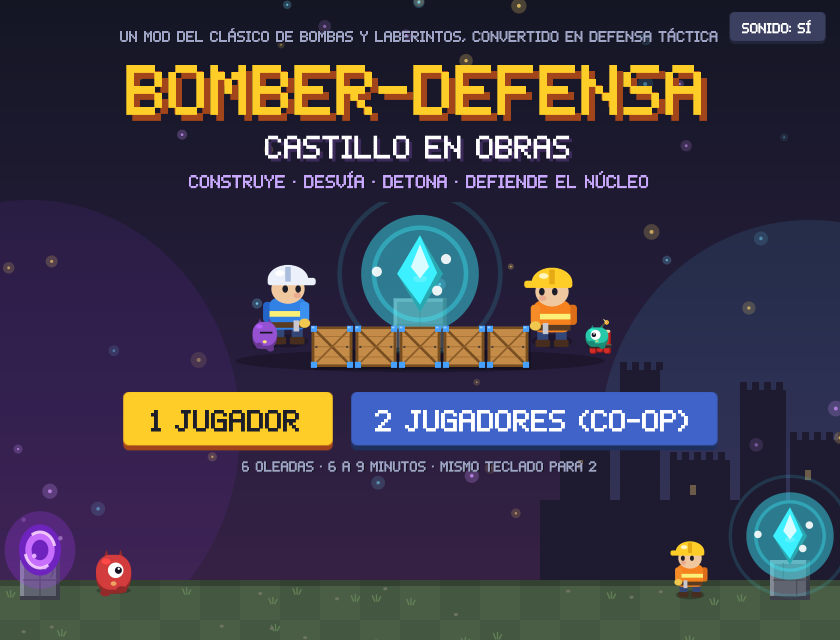

# Bomber-Defensa: Castillo en Obras

Mod de nuestro juego de bombas y laberintos *Bomber Mario*, convertido en una defensa táctica para 1 jugador o 2 en cooperativo en el mismo teclado.

Los Autómatas salen de un portal y buscan el camino más corto hasta el Núcleo. Tú levantas muros para alargarles la ruta (nunca puedes cerrarla) y los detienes con dinamita, que también rompe tus propios muros. Hay que sobrevivir 6 oleadas.

Equipo: Daniel Castro, Laura Revelo, Katerine Valens, Jeanpaul Vidales.



## Cómo ejecutarlo

Necesitas Java 19 o superior. Maven se descarga solo.

Windows:

```
git clone https://github.com/lauraV-rv/bomber-defensa.git
cd bomber-defensa\BomberMario\BomberMario
mvnw.cmd javafx:run
```

Mac / Linux:

```
git clone https://github.com/lauraV-rv/bomber-defensa.git
cd bomber-defensa/BomberMario/BomberMario
./mvnw javafx:run
```
