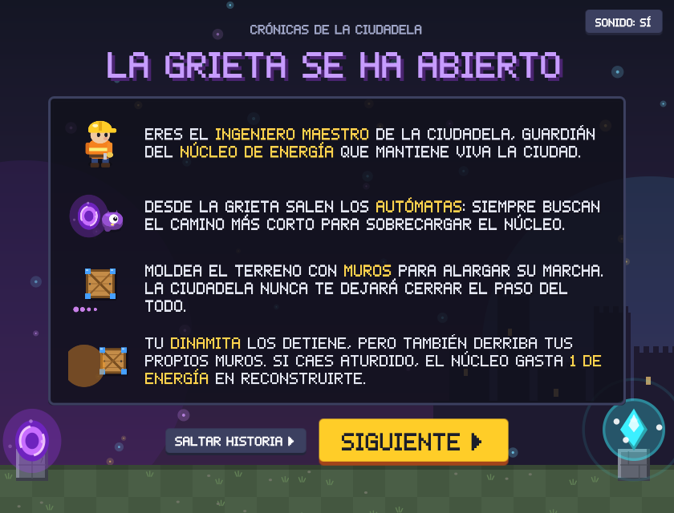
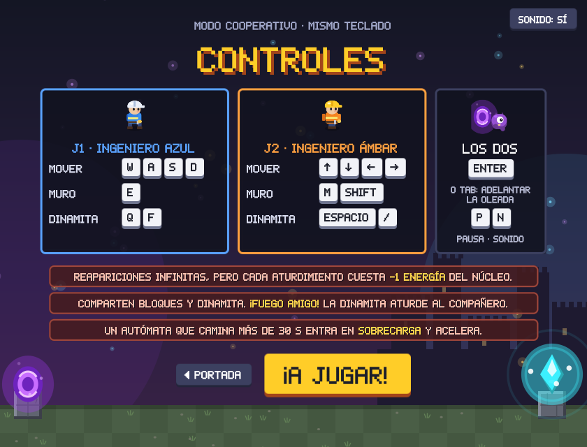
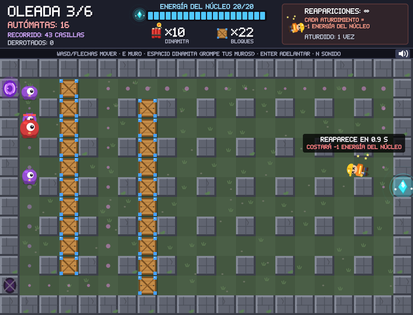
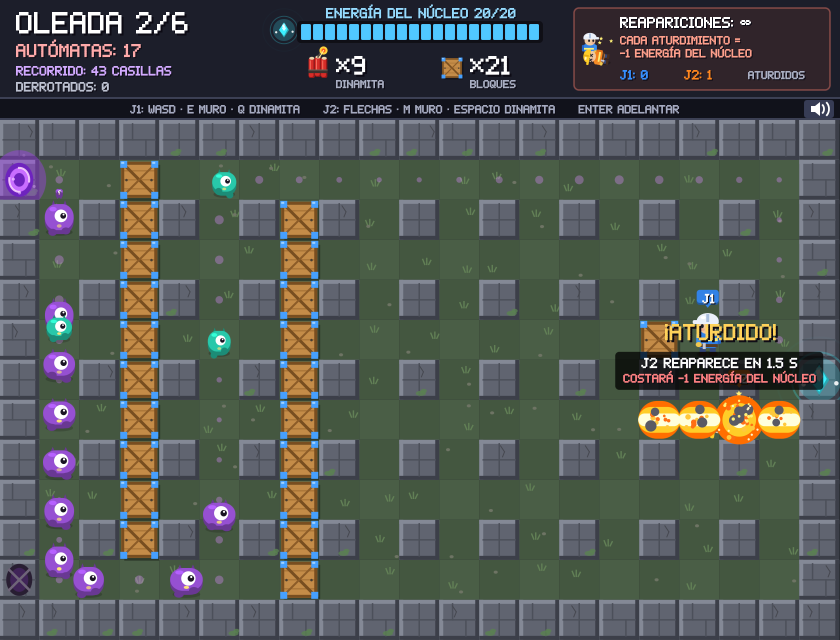
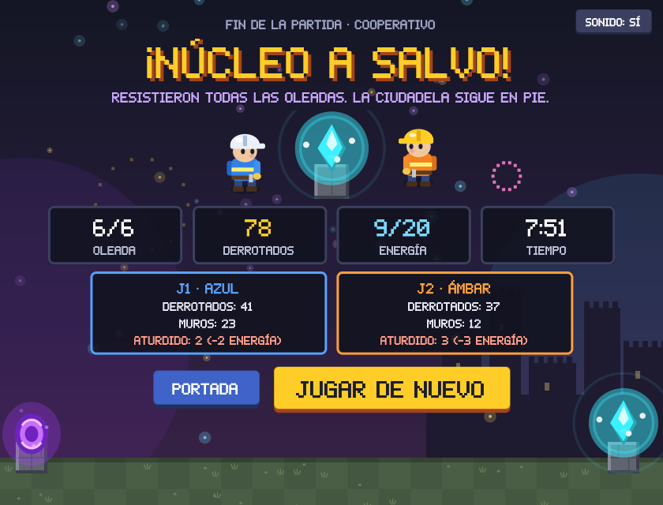
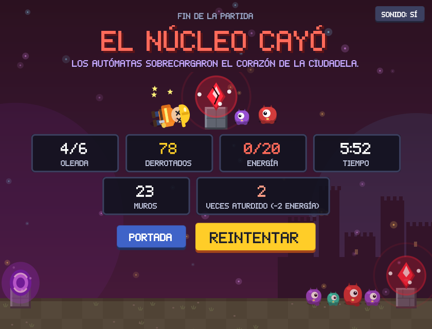

# Castillo en Obras (Mod táctico y cooperativo basado en Bomberman)

**Bomber-Defensa: Castillo en Obras** es un mod de nuestro juego de bombas y laberintos (*Bomber Mario*) que cambia el género: de arcade de acción a **defensa táctica (tower defense)** con construcción en tiempo real, para **1 jugador o 2 en cooperativo** en el mismo teclado.

Desde la Grieta salen los **Autómatas** y buscan el camino más corto hasta el **Núcleo de Energía** de la Ciudadela. Ustedes no los persiguen: levantan muros para alargarles la ruta y usan dinamita para detenerlos... con cuidado de no volar sus propias defensas.

Trabajo final del curso — Opción 2: *Crear un Mod para un juego existente*.

**Equipo:** Daniel Castro · Laura Revelo · Katerine Valens · Jeanpaul Vidales


## Cómo ejecutarlo

Solo necesitas **Java 19 o superior (JDK)**. Maven se descarga solo con el wrapper incluido (`mvnw`).
Comprueba tu Java con `java -version`.

**Windows** (PowerShell o CMD):

```bat
git clone <URL-del-repositorio>
cd <carpeta-del-repositorio>\BomberMario\BomberMario
mvnw.cmd javafx:run
```

**Mac / Linux**:

```bash
git clone <URL-del-repositorio>
cd <carpeta-del-repositorio>/BomberMario/BomberMario
./mvnw javafx:run
```

Si ya tienes Maven instalado, también sirve `mvn javafx:run` dentro de `BomberMario/BomberMario`.
Si `mvnw` dice que `JAVA_HOME` no está definido, apúntalo a la carpeta de tu JDK (por ejemplo `C:\Program Files\Java\jdk-22`).

## Controles

### 1 jugador

| Acción | Teclas |
|---|---|
| Moverse | `W A S D` o flechas |
| Construir muro (en la casilla de enfrente) | `E` |
| Poner dinamita | `Espacio` |
| Empezar la oleada antes de tiempo | `Enter` |
| Pausa | `P` o `Esc` |
| Sonido | `N` (o `M`) |

### 2 jugadores (co-op, mismo teclado)

| Acción | J1 · Ingeniero azul | J2 · Ingeniero ámbar |
|---|---|---|
| Moverse | `W A S D` | Flechas |
| Construir muro | `E` | `M` o `Shift` |
| Poner dinamita | `Q` o `F` | `Espacio` o `/` |

Para los dos: `Enter` o `Tab` adelanta la oleada, `P`/`Esc` pausa y `N` silencia.
También hay botones de pausa y sonido en la esquina inferior derecha del HUD.

## Reglas principales

- **6 oleadas** de Autómatas con fases de construcción entre ellas. Una partida dura entre **6 y 9 minutos**.
- **Muros con validación BFS:** cada vez que intentas construir, el juego hace una búsqueda en anchura (BFS) desde el Núcleo. Si el muro dejaría a un portal o a un Autómata sin camino, no se puede poner ("¡Bloquearías el camino!"). Puedes alargar la ruta, nunca cerrarla. La ruta actual se ve punteada en el suelo.
- **Dinamita en cruz:** derrota Autómatas, pero también **rompe tus propios muros** y **aturde a cualquier ingeniero** que esté en la explosión. En co-op eso incluye a tu compañero (**¡fuego amigo!**). Solo una dinamita encendida por jugador.
- **Reapariciones ligadas al Núcleo:** reapareces infinitas veces, pero cada vez que te aturden el Núcleo gasta **1 de energía** en reconstruirte. Si la energía llega a 0, pierden.
- **Recursos compartidos:** bloques y dinamita son de todo el equipo. Si se acaba la dinamita en plena oleada, llega **1 de emergencia** a los 5 segundos. Los Autómatas a veces sueltan más.
- **Tres tipos de Autómatas:** Rasos, Veloces y Brutos (aguantan 3 golpes). Si un Autómata lleva más de 30 s caminando entra en **Sobrecarga** y acelera.
- **Co-op:** 25 % más Autómatas por oleada y más recursos iniciales.

## Qué cambió respecto al juego original

| Juego original | Castillo en Obras |
|---|---|
| Perseguir enemigos y abrir una puerta | Defender el Núcleo durante 6 oleadas |
| Las bombas son solo un arma | La dinamita es arma y riesgo: rompe tus defensas y aturde |
| Laberinto aleatorio fijo | Tú moldeas el laberinto en tiempo real |
| Enemigos que deambulan o persiguen | Autómatas que recalculan la ruta más corta (BFS) |
| 1 jugador | 1 jugador o 2 en cooperativo local |

Todo el arte, la fuente pixelada (`PixelFont`) y los efectos de sonido (`SoundManager`) se generan por código: el juego no usa imágenes, fuentes ni audios de terceros.

## Estructura del código

```
BomberMario/BomberMario/src/main/java/com/example/bombermario/
├── Screens/DefenseScreen.java   reglas de la partida, oleadas, HUD
├── model/Board.java             grilla, muros y validación BFS
├── model/Enemy.java             Autómatas que siguen la ruta más corta
├── model/Avatar.java            ingenieros y controles de cada jugador
├── model/Art.java               dibujo por código de todos los personajes y bloques
├── audio/SoundManager.java      efectos de sonido sintetizados
├── ui/PixelFont.java            fuente pixelada propia
└── control/                     portada, historia, controles y pantallas finales
```

## Capturas

| | |
|---|---|
|  |  |
|  |  |
|  |  |
